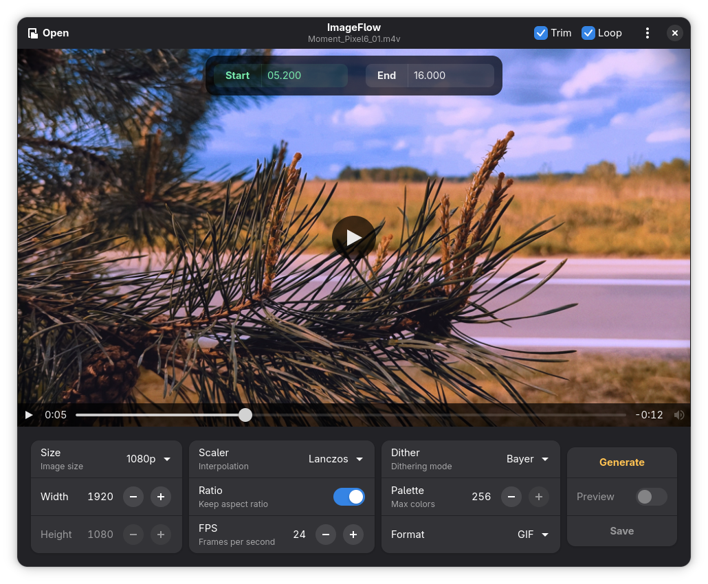

<!-- markdownlint-disable -->
<div align="center">
  
</div>
<h1 align="center">ImageFlow</h1>
<p align="center">Application for converting video files to high‑quality animated images.</p>
<p align="center">
  
</p>
<!-- markdownlint-enable -->


## Description

This application converts videos into animated **GIF**, **WebP**, and **AVIF** images using the **FFmpeg** library. You can configure key parameters, including output size, frame rate, filters (such as interpolation and dithering), palette-generation method, and maximum number of colors.


### Features

- All conversion parameters can be configured.
- Crop video frames to a custom region.
- Remove individual frames or selected frame ranges.
- Time range selection option.
- Preview of the result.
- Support for many formats.
- Intuitive and user-friendly interface.


### ToDo

- [x] Initial release.
- [x] WebP encoding options.
- [x] Time range selection.
- [x] AVIF support.
- [ ] WebP and AVIF preview.


## Installation

The built packages are available on the [releases](https://github.com/oluka007/ImageFlow/releases) page.


### AppImage

Download the latest AppImage from the [releases](https://github.com/oluka007/ImageFlow/releases) page. Make it executable, then run it:

```
chmod +x ImageFlow-*-x86_64.AppImage
./ImageFlow-*-x86_64.AppImage
```


### GNOME Builder

GNOME Builder offers the easiest method to build and test ImageFlow. Clone the repository and press the «Run Project» button to compile.


### Build from source

```
git clone https://github.com/oluka007/ImageFlow
cd ImageFlow

meson setup build
ninja -C build install
```

By default, meson should install ImageFlow to `/usr/local`.

### Build an AppImage

On Ubuntu 24.04, install the build dependencies and AppImage Builder, then run:

```
sudo apt install appstream desktop-file-utils gettext gir1.2-adw-1 \
  gir1.2-gtk-4.0 libadwaita-1-dev libgtk-4-dev meson ninja-build pipx \
  python3-gi
pipx install appimage-builder
packaging/build-appimage.sh
```


## License

ImageFlow is a [free software](https://www.gnu.org/philosophy/free-sw.html) and will always be free. It is released under the terms of the [GNU General Public License](./COPYING).


## Copyright

This fork is maintained by [oluka007](https://github.com/oluka007). ImageFlow was
originally created by [Golodnikov Sergey](https://github.com/GS90).
